<div align="center">

# 📦 E-Commerce Shipping Delivery Prediction

### Predicting whether an e-commerce shipment will reach the customer on time, using machine learning

[](https://ecommerce-delivery-prediction.vercel.app)


**[🌐 Visit the live project website →](https://ecommerce-delivery-prediction.vercel.app)**

<a href="https://ecommerce-delivery-prediction.vercel.app">
  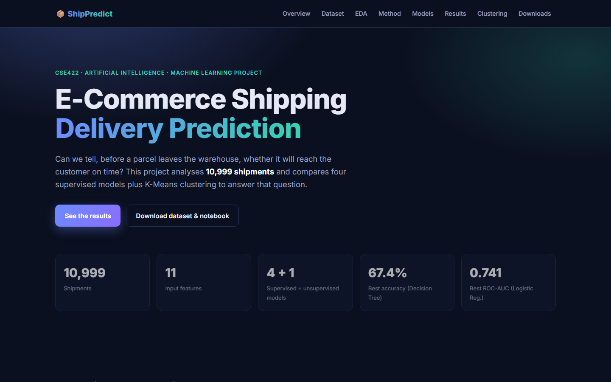
</a>

</div>

---

## 📑 Table of Contents
- [Overview](#-overview)
- [Live Website](#-live-website)
- [Dataset](#-dataset)
- [Exploratory Data Analysis](#-exploratory-data-analysis)
- [Methodology](#️-methodology)
- [Models & Results](#-models--results)
- [K-Means Clustering](#-k-means-clustering)
- [Conclusion](#-conclusion)
- [Project Structure](#-project-structure)
- [Run Locally](#-run-locally)
- [Author](#-author)

---

## 📝 Overview

On-time delivery is one of the biggest drivers of customer satisfaction in e-commerce. Late parcels lead to unhappy customers, more customer-care calls and higher operational costs.

This project treats the problem as a **binary classification** task. Given shipment, product and customer details, it predicts `Reached.on.Time_Y.N`. It compares **four supervised models** and uses **K-Means clustering** to explore hidden patterns.

| | |
|---|---|
| 🎯 **Task** | Binary classification |
| 📊 **Samples** | 10,999 shipments × 12 columns |
| 🧩 **Features** | 11 inputs (4 categorical, 7 numerical) |
| ✂️ **Split** | 70% train (7,699) / 30% test (3,300), stratified |
| 🤖 **Models** | Logistic Regression · KNN · Decision Tree · Neural Network (MLP) · K-Means |
| 🏆 **Best accuracy** | **67.42%** (Decision Tree) |
| 📈 **Best ROC-AUC** | **0.741** (Logistic Regression) |

> 🎓 Developed for the **CSE422: Artificial Intelligence** course.

---

## 🌐 Live Website

All of the project is available as an interactive website:

### 👉 **https://ecommerce-delivery-prediction.vercel.app**

| Section | What you'll find |
|---|---|
| 📋 **Overview** | Problem statement and project summary |
| 📊 **Dataset** | Feature dictionary, class balance, category breakdowns and an **interactive data explorer** where you can search and filter all 10,999 rows |
| 🔍 **EDA** | Every chart from the notebook (click to zoom) with key insights |
| ⚙️ **Methodology** | The 8-step ML pipeline and the training code |
| 🤖 **Models** | One tab per model with its classification report, confusion matrix and ROC curve |
| 🏆 **Results** | Comparison table, an interactive metric chart and comparison plots |
| 🧠 **Clustering** | K-Means elbow method and PCA visualisation |
| ⬇️ **Downloads** | Dataset (CSV) and the full Jupyter notebook |

---

## 📊 Dataset

**E-commerce Shipping Dataset**: 10,999 shipments with **no missing values**.

| Feature | Type | Description | Range / Values |
|---|---|---|---|
| `ID` | numeric | Customer / row identifier | 1 – 10,999 |
| `Warehouse_block` | categorical | Warehouse block the product shipped from | A, B, C, D, F |
| `Mode_of_Shipment` | categorical | How the product was shipped | Ship, Flight, Road |
| `Customer_care_calls` | numeric | Calls made about the shipment | 2 – 7 |
| `Customer_rating` | numeric | Customer rating of the company | 1 – 5 |
| `Cost_of_the_Product` | numeric | Product cost (USD) | 96 – 310 |
| `Prior_purchases` | numeric | Number of earlier purchases | 2 – 10 |
| `Product_importance` | categorical | Importance of the product | low, medium, high |
| `Gender` | categorical | Customer gender | F, M |
| `Discount_offered` | numeric | Discount on the product (%) | 1 – 65 |
| `Weight_in_gms` | numeric | Product weight (grams) | 1,001 – 7,846 |
| 🎯 **`Reached.on.Time_Y.N`** | **target** | **Delivery outcome** | **1 = on time · 0 = not on time** |

**Class balance:** 6,563 shipments (59.7%) are class 1 and 4,436 (40.3%) are class 0. The imbalance is moderate, so accuracy alone can mislead.

<div align="center">
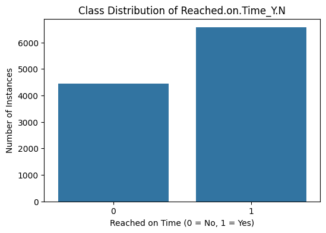
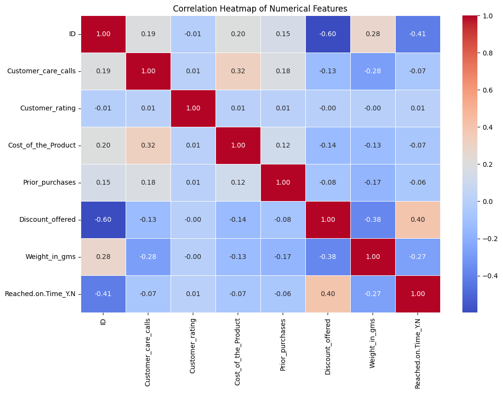
<br/><em>Left: class distribution of the target · Right: correlation heatmap of the numerical features</em>
</div>

---

## 🔍 Exploratory Data Analysis

<div align="center">
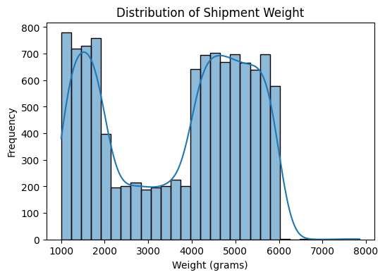
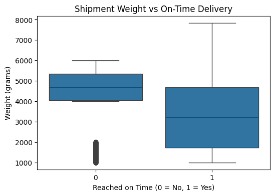
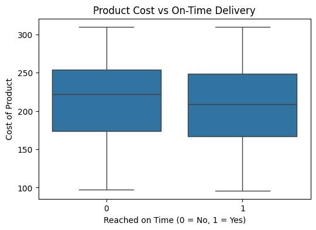
<br/><em>Shipment weight distribution · Weight vs delivery · Product cost vs delivery</em>
<br/><br/>
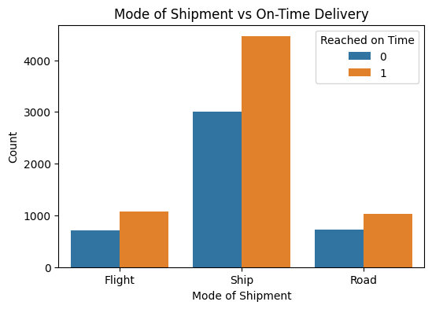
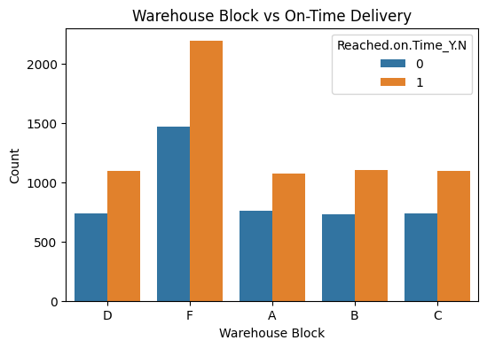
<br/><em>Mode of shipment vs delivery · Warehouse block vs delivery</em>
</div>

### 💡 Key insights
| | Insight |
|---|---|
| 💸 | **Discount is the strongest signal.** Every shipment with a discount above 10% has target = 1, compared with only 46.9% below that (correlation **+0.40**). |
| ⚖️ | **Weight matters.** `Weight_in_gms` has a correlation of **−0.27** with the target. |
| 📞 | **More customer-care calls mean fewer class-1 outcomes.** The share drops from 65% (2 calls) to 52% (6–7 calls). |
| ⭐ | **High-importance products** have a higher class-1 share (65%) than low or medium (≈59%). |
| 🚢 | **Mode, warehouse and gender barely matter.** Each stays within about 1–2 points of the overall rate. |

---

## ⚙️ Methodology

```
 1. Load & inspect   →  2. EDA            →  3. Null check (0 missing)  →  4. Label encoding
 5. StandardScaler   →  6. 70/30 split    →  7. Train & evaluate         →  8. K-Means + PCA
```

```python
X = df_encoded.drop('Reached.on.Time_Y.N', axis=1)
y = df_encoded['Reached.on.Time_Y.N']
X_scaled = StandardScaler().fit_transform(X)

X_train, X_test, y_train, y_test = train_test_split(
    X_scaled, y, test_size=0.30, random_state=42, stratify=y)

models = {
    "Logistic Regression": LogisticRegression(max_iter=1000, random_state=42),
    "KNN":                 KNeighborsClassifier(n_neighbors=5),
    "Decision Tree":       DecisionTreeClassifier(criterion='gini', max_depth=10, random_state=42),
    "Neural Network":      MLPClassifier(hidden_layer_sizes=(64, 32), activation='relu',
                                         solver='adam', max_iter=300, random_state=42),
}
```

---

## 🤖 Models & Results

All scores are measured on the held-out **test set of 3,300 shipments**. The best score in each column is in **bold**.

| Model | Accuracy | Precision (1) | Recall (1) | F1 (1) | Macro F1 | ROC-AUC |
|---|:-:|:-:|:-:|:-:|:-:|:-:|
| Logistic Regression | 0.6621 | 0.7354 | 0.6775 | **0.71** | 0.65 | **0.7411** 🥇 |
| K-Nearest Neighbors | 0.6588 | 0.7277 | **0.6841** | **0.71** | 0.65 | 0.7306 |
| Decision Tree | **0.6742** 🥇 | **0.8392** | 0.5617 | 0.67 | **0.67** | 0.7324 |
| Neural Network (MLP) | 0.6548 | 0.7388 | 0.6521 | 0.69 | 0.65 | 0.7370 |

<div align="center">
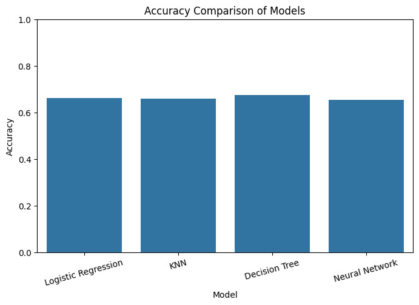
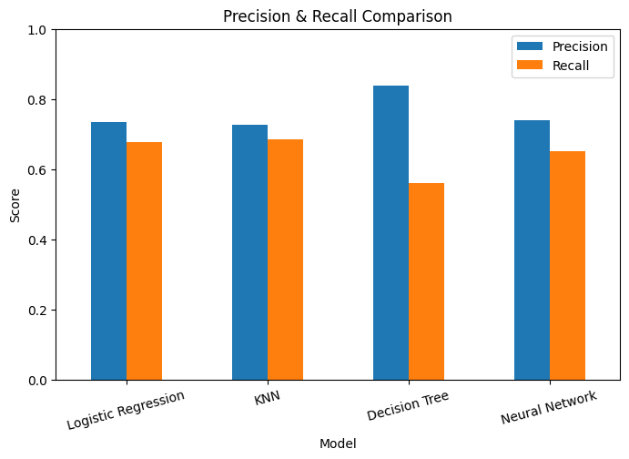
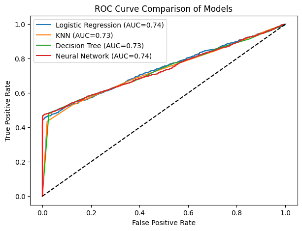
<br/><em>Accuracy comparison · Precision & recall comparison · ROC curves of all models</em>
</div>

### 🔎 Confusion matrices

<div align="center">
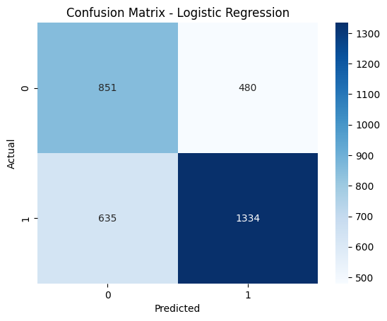
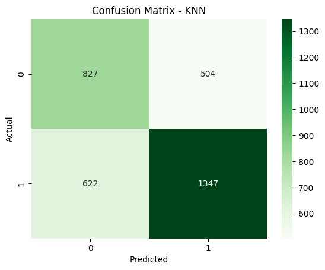
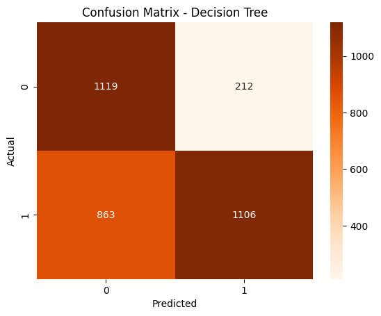
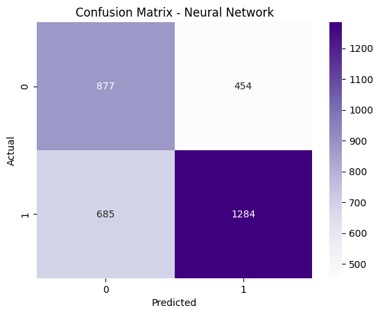
<br/><em>Logistic Regression · KNN · Decision Tree · Neural Network</em>
</div>

<details>
<summary><b>📈 Individual ROC curves (click to expand)</b></summary>
<br/>
<div align="center">
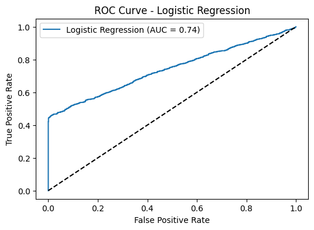
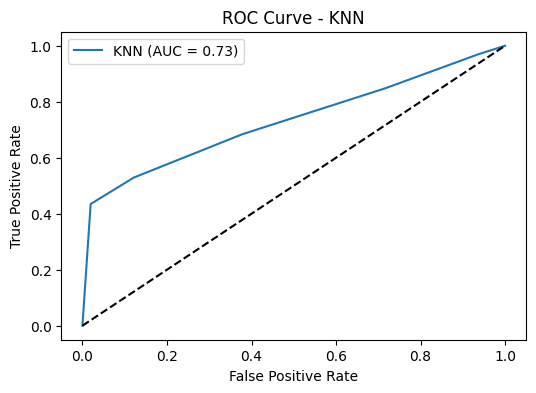
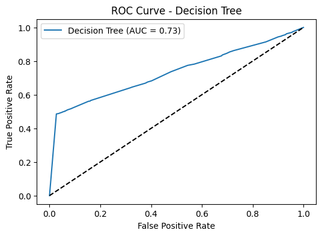
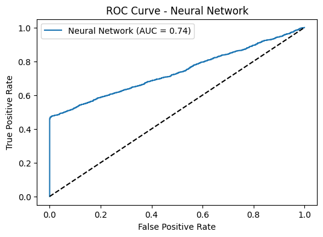
</div>
</details>

### 🏆 Verdict
- 🥇 **Decision Tree** has the **highest accuracy (67.4%)** and **precision (0.84)**. It is conservative, though, and its recall drops to 0.56.
- 📈 **Logistic Regression** has the **best ROC-AUC (0.741)**. It ranks shipments best and is the simplest model to interpret.
- ⚖️ **Neural Network** and **KNN** keep precision and recall the most balanced (≈0.73 / 0.65–0.68).

---

## 🧠 K-Means Clustering

K-Means was run on the scaled features for *k* = 1…10. The **elbow method** selected **k = 2**, and the clusters were visualised in 2D with **PCA**.

<div align="center">
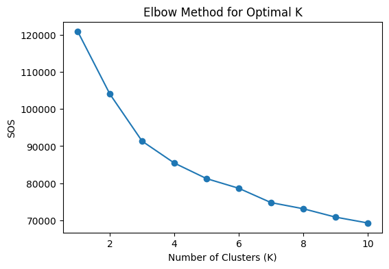
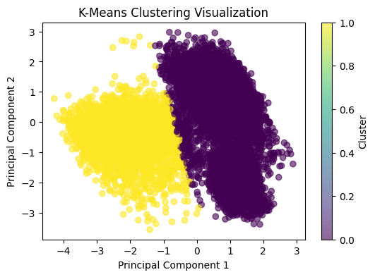
<br/><em>Elbow method for optimal K · K-Means clusters (PCA projection)</em>
</div>

---

## ✅ Conclusion

- All four supervised models score within a narrow band: **65–67% accuracy** and **0.73–0.74 ROC-AUC**.
- Because the classes are imbalanced, **precision, recall and AUC** separate the models better than accuracy does.
- **Discount offered**, **product weight** and **customer care calls** are the most informative features.
- K-Means with PCA gives a complementary view of shipment segments that does not use the labels.

**🚀 Future work:** drop the `ID` column, one-hot encode the nominal features, try ensembles (Random Forest, XGBoost), tune hyperparameters with cross-validation, and handle the imbalance with class weights or SMOTE.

---

## 📁 Project Structure

```
ecommerce-delivery-prediction/
│
├── 08_24141162_22301202_06.ipynb        # Main notebook: EDA, models, evaluation
├── ecommerce-delivery-prediction-main/
│   ├── data/E-commerce Shipping Dataset.csv
│   └── notebook/ecommerce_delivery_prediction.ipynb
│
├── website/                              # 🌐 Project website (deployed on Vercel)
│   ├── index.html
│   ├── style.css
│   ├── script.js
│   ├── assets/img/                       # Charts exported from the notebook
│   └── data/                             # Downloadable CSV + notebook
│
├── vercel.json                           # Vercel config (serves /website)
└── README.md
```

---

## 💻 Run Locally

**Notebook**
```bash
pip install pandas numpy scikit-learn matplotlib seaborn jupyter
jupyter notebook 08_24141162_22301202_06.ipynb
```
> The notebook was written in Google Colab. Before running it locally, change the CSV path in the second cell to `ecommerce-delivery-prediction-main/data/E-commerce Shipping Dataset.csv`.

**Website**
```bash
cd website
python -m http.server 8000      # then open http://localhost:8000
```

**Deploy to Vercel**
```bash
cd website
npx vercel deploy --prod
```

---

## 🛠️ Technologies Used

| Category | Tools |
|---|---|
| Language | 🐍 Python |
| Data | 🧮 Pandas · 🔢 NumPy |
| Machine learning | 📚 Scikit-learn |
| Visualisation | 📊 Matplotlib · 🎨 Seaborn |
| Environment | 📓 Jupyter Notebook / Google Colab |
| Website | 🌐 HTML · CSS · JavaScript · ▲ Vercel |

---

## 👤 Author

**Khandoker Md. Ragib Ahsan**
CSE422: Artificial Intelligence · Group 08

[](https://github.com/ragibKhandoker)
[](https://ecommerce-delivery-prediction.vercel.app)

---

<div align="center">

⭐ **If you found this project useful, consider giving it a star!** ⭐

<sub>This project is intended for academic and learning purposes.</sub>

</div>
